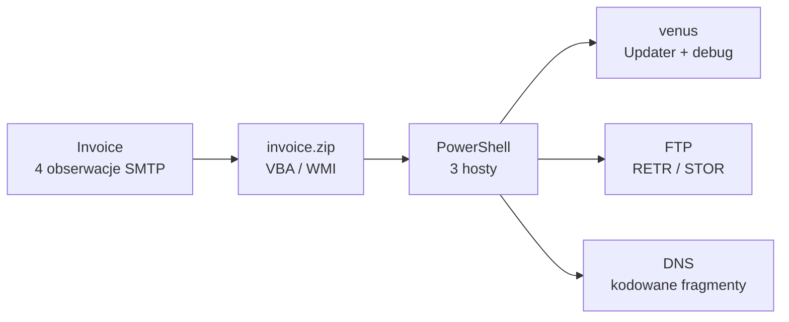

# Od alertu phishingowego do dochodzenia DFIR

**Portfolio SOC · SOC L1 → SOC L2 → DFIR**

## Wstęp

Projekt powstał, żeby przećwiczyć pracę analityka SOC: od wykrycia podejrzanej wiadomości, przez triage i eskalację, po analizę skutków incydentu. Zacząłem od prostego pytania: czy na podstawie logów uda mi się wykryć kampanię phishingową i ustalić, co wydarzyło się później na komputerach odbiorców?

> **Zacznij od [Historii projektu](project-story.md).** Opisuję tam swoją drogę od pierwszego alertu do analizy DFIR, współpracę z AI, ślepe uliczki i wnioski z całej pracy.

Do analizy wykorzystałem [Boss of the SOC v2 (BOTSv2)](https://github.com/splunk/botsv2), udostępniony przez Splunk zbiór danych do ćwiczeń z cyberbezpieczeństwa. Zawiera on logi ze środowiska fikcyjnej firmy Frothly, pozwalające badać aktywność użytkowników, systemów i sieci. Dane źródłowe są dostępne na [licencji CC0 1.0 Universal](https://github.com/splunk/botsv2/blob/master/LICENSE).

W Splunku zbudowałem własną regułę `SOC-DET-001`, która wskazała wiadomości z identycznym załącznikiem ZIP wysłane do kilku odbiorców. Nie korzystałem z gotowej listy pytań ani odpowiedzi do BOTSv2 jako planu dochodzenia. Sprawdzałem kolejne hipotezy w logach pocztowych, zdarzeniach z komputerów i ruchu sieciowym. Analiza doprowadziła do śladów wykonania kodu na trzech hostach, mechanizmu persistence oraz eksfiltracji danych przez FTP i podejrzanego ruchu DNS.

Badane zdarzenia pochodzą z **24-26 sierpnia 2017 r.**, a dochodzenie prowadziłem w **listopadzie 2026 r.** Alert powstał podczas mojej pracy z danymi. Wyniki badań odzyskanej próbki w sandboxach z 2026 r. traktowałem jako uzupełnienie historycznych logów.

Korzystałem z pomocy AI przy tworzeniu SPL, stawianiu hipotez i porządkowaniu wniosków. Sam wykonywałem zapytania, sprawdzałem artefakty i weryfikowałem interpretacje w narzędziach.

## Wynik dochodzenia

| Obszar | Ustalenie |
| --- | --- |
| Pierwotny alert | 4 wiadomości `Invoice` z `invoice.zip` |
| Wykonanie kodu | 3 hosty z `WmiPrvSE.exe → powershell.exe -enc` |
| Transfery FTP | 14 udanych pobrań `RETR`; 707 udanych wysyłek `STOR` |
| Kanał DNS | 1857 unikalnych FQDN z kodowanymi fragmentami; 424 identyczne nazwy w dwóch grupach ruchu |
| Werdykt | **True Positive · High** (ocena analityczna) |

Najistotniejszy wniosek: wykrycie podejrzanych e-maili było tylko początkiem. Korelacja logów pocztowych, Sysmon, rejestru Windows oraz ruchu FTP i DNS pozwoliła odtworzyć znacznie szerszą aktywność. Jednocześnie nie utożsamiam udanego przesłania pliku z jego odszyfrowaniem ani zakodowanego ruchu DNS z odzyskaniem kompletnej zawartości przez odbiorcę.

## Ścieżka incydentu

*Schemat pokazuje rozpoznane etapy i współwystępujące zachowania. Nie oznacza, że dla każdego połączenia potwierdzono pełny łańcuch przyczynowy.*

## Od czego zacząć?

| Materiał | Co pokazuje |
| --- | --- |
| [Historia projektu](project-story.md) | Jak prowadziłem dochodzenie, czego się nauczyłem i gdzie musiałem korygować hipotezy |
| [SOC L1](reports/SOC-L1.md) | Triage, IOC dostępne na etapie alertu i decyzja o eskalacji |
| [SOC L2](reports/SOC-L2.md) | Korelacja hostów i sieci, ocena zagrożenia i rekomendacje IR |
| [DFIR](reports/DFIR.md) | Rekonstrukcja incydentu, ocena skutków, granice dowodowe i wnioski |
| [SPL: prototyp detekcji](technical/soc-l1-spl.md) | Logika reguły `SOC-DET-001`, historyczne zapytania i ograniczenia |
| [Evidence Matrix](evidence/evidence-matrix.md) | Najważniejsze twierdzenia i źródła, które je wspierają |

Dodatkowe zestawienia: [oś czasu](technical/timeline.md), [IOC](technical/ioc.md), [MITRE ATT&CK](technical/mitre-attack.md) i [metodyka](methodology.md).

Wersje A4 do pobrania: [SOC L1 (PDF)](reports/SOC-L1.pdf), [SOC L2 (PDF)](reports/SOC-L2.pdf), [DFIR (PDF)](reports/DFIR.pdf).

## Narzędzia i źródła

Splunk SPL, logi SMTP/FTP/DNS/TCP, Sysmon, WinRegistry, analiza VBA w REMnux, CyberChef, ANY.RUN i tria.ge. Interpretację zachowań uporządkowano według MITRE ATT&CK, a dokumentację incydentu przygotowano z odniesieniem do NIST SP 800-61 Rev. 3, NIST CSF 2.0 i NIST SP 800-86.

Repozytorium nie zawiera próbek malware, pełnych payloadów ani kompletnego datasetu BOTSv2. Dataset można pobrać ze [strony projektu BOTSv2](https://github.com/splunk/botsv2#download).
