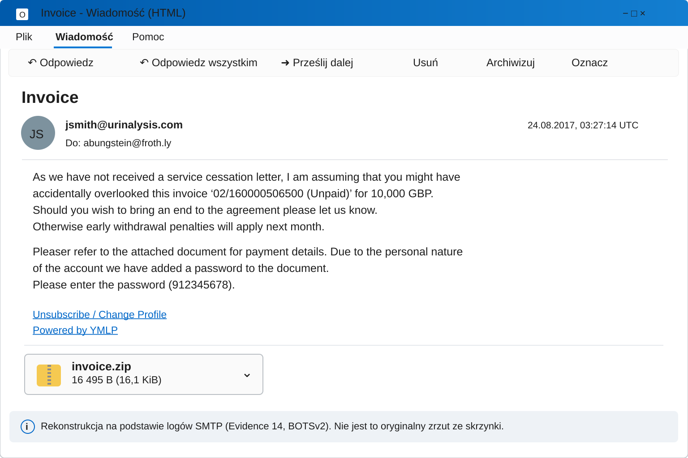

# Od jednego alertu do dochodzenia

*Jak zacząłem od phishingu w logach BOTSv2, a skończyłem na analizie SOC L2 i DFIR.*

## 1. Po co zacząłem ten projekt?

Skończyłem szkolenia **Security Starter** i  **Security Analyst - Krok pierwszy** w [szkolasecurity.pl](http://szkolasecurity.pl) Na zakończenie kursu powinienem zrobić projekt końcowy. Miałem początkowo dość prosty plan. Chciałem znaleźć bazę logów, na której mógłbym poćwiczyć pracę w Splunku i przeprowadzić analizę przypominającą codzienne zadania analityka SOC. Wiedziałem, że chcę zacząć od phishingu. Zależało mi nie na samym odnalezieniu podejrzanego e-maila, ale na przejściu całej drogi: od alertu, przez jego weryfikację, do decyzji, czy sprawę należy eskalować. Maile phishingowe dostaję codziennie na swoją skrzynkę, ale ich analiza nie pozwoliłaby mi pracować w SIEM ani przejść realistyczną ścieżkę analityka SOC L1.

Tak trafiłem na BOTSv2. Znałem jego rolę jako zbioru logów do ćwiczeń, ale nie znałem oryginalnego scenariusza, listy zadań ani przygotowanych odpowiedzi. Nie korzystałem z nich jako planu śledztwa. Wziąłem dane historyczne i postanowiłem zbudować własny punkt wejścia.

Alert `SOC-DET-001` powstał więc już podczas mojej pracy z danymi. Nie jest historycznym zgłoszeniem wygenerowanym przez SOC firmy Frothly w 2017 roku. To moja retrospektywna detekcja, skonstruowana po to, żeby można było rozpocząć realistyczny triage.

Regułę oparłem na prostym pomyśle: jeśli w krótkim czasie ten sam załącznik trafia do co najmniej trzech różnych skrzynek, warto się temu przyjrzeć. W logach znalazłem czterech odbiorców. Sam alert nie mówił jeszcze, że któryś z nich otworzył plik, ale dawał konkretny powód, żeby sprawdzić wiadomości i przekazać podejrzane zdarzenie do głębszej analizy.

Zacząłem od wiadomości z tematem `Invoice` i załącznikiem `invoice.zip`. Sprawdzałem nadawcę, odbiorców, nagłówki i metadane pliku. Na tym etapie mógłbym zakończyć ćwiczenie: opisać wyniki L1, uzasadnić eskalację i przekazać temat dalej. Tyle że pojawiły się kolejne artefakty. Chciałem sprawdzić, dokąd prowadzą.

**Rysunek 1. Rekonstrukcja wiadomości „Invoice” na podstawie Evidence 14 (logi SMTP).** Treść wiadomości odtworzono z kodu HTML, pomijając znaczniki i artefakty kodowania. Nie jest to oryginalny zrzut ekranu ze skrzynki odbiorczej.

## 2. Kiedy analiza e-maila stała się czymś większym?

Najpierw był dokument Word i jego makra. Potem zakodowane polecenie PowerShell, uruchamianie procesów przez WMI i zdarzenia Sysmon, które pozwoliły szukać tego zachowania na komputerach z datasetu. Na komputerze o wdzięcznej nazwie `venus` znalazłem później ślady zadania harmonogramu i skryptu zapisanego w rejestrze. W logach z kolejnego dnia pojawiły się też polecenia cichej instalacji Pythona i uruchomienie skryptu`dns.py`.

W pewnym momencie wiedziałem już, że nie badam wyłącznie wiadomości phishingowej. Próba zrozumienia jej skutków prowadziła mnie przez kolejne etapy aktywności na kilku komputerach.

Zapamiętałem zwłaszcza moment z zadaniem `Updater w Harmonogramie Zadań`. Samo jego utworzenie wyglądało podejrzanie, ale dopiero powiązanie zadania z wartością `debug` w utworzonym kluczu rejestru Windows pokazało, jak ten mechanizm miał działać. Wartość zawierała zakodowany skrypt PowerShell, który można było odczytać bez jego uruchamiania. Mieliśmy dowód zapisania payloadu i rejestracji zadania, ale nie dowód, że zadanie później faktycznie się wykonało.

Nie zakładałem wcześniej, że zajmę się transferami FTP albo dekodowaniem subdomen DNS. Szczerze mówiąc, wcześniej nie wiedziałem nawet, że istnieje coś takiego jak DNS tunneling! Gdy zobaczyłem długą listę zapytań z podobnie zbudowanymi, pozornie losowymi subdomenami, od razu zwróciły moją uwagę. Chciałem sprawdzić, co się w nich kryje.

Po dekodowaniu w CyberChef okazało się, że te ciągi mają określoną strukturę. Cztery pierwsze bajty odpowiadały numerowi fragmentu, a kolejne osiem zawierało dane. Wśród nich znaleźliśmy fragment zgodny ze strukturą pliku JPEG. Później w Splunku udało się też znaleźć 424 identyczne pełne nazwy domenowe widoczne w dwóch różnych grupach ruchu DNS. To było dla mnie zupełnie nowe doświadczenie. Jednocześnie nie udało się odtworzyć całego pliku, więc nie mogliśmy powiedzieć, że pełna eksfiltracja zakończyła się sukcesem.

Osobnym zaskoczeniem były transfery FTP. W logach widzieliśmy najpierw pobieranie narzędzi, a później polecenia `STOR`, czyli wysyłanie plików na zewnętrzny serwer. Ostatecznie potwierdziliśmy 707 udanych operacji przesyłania, w tym pliku o nazwie `frothly_passwords.kdbx`. To zmieniło ocenę możliwych skutków incydentu, ale nadal nie dawało odpowiedzi na pytanie, kto miał dostęp do przesłanych plików i czy były później wykorzystywane.

Historyczny charakter BOTSv2 też miał znaczenie. Incydent rozgrywał się w 2017 roku, a my analizowaliśmy go kilka lat później. Sprawdzenie adresu IP w **AbuseIPDB** mogło dać jakiś kontekst, ale aktualna reputacja adresu nie mówiła, kto go używał podczas tamtego incydentu. Adresy i domeny mogły przecież zmienić właścicieli. To ograniczenie, z którym trzeba było się pogodzić. Mimo wszystko było warto ciągnąć analizę dalej. Praca z [**ANY.RUN**](http://ANY.RUN)**, tria.ge** i postawienie środowiska REMnux do analizy malware były dla mnie naprawdę wartościowym doświadczeniem.

## 3. Praca z AI: wspólna analiza zamiast gotowej odpowiedzi

Przy tym projekcie korzystałem ze wsparcia AI znacznie szerzej niż przy zwykłym pisaniu tekstów. Pomagało mi budować zapytania SPL, formułować hipotezy, interpretować wyniki i planować kolejne sprawdzenia. Im dalej szło dochodzenie, tym bardziej skomplikowane stawały się zapytania i tym cenniejsza była możliwość przedyskutowania pomysłu, zanim uruchomiłem następny test.

Nie wyglądało to jednak tak, że przekazałem AI zadanie i dostałem gotową analizę. Pracowałem w Splunku, wykonywałem zapytania, oglądałem zdarzenia, korzystałem z CyberChef, porównywałem artefakty i wracałem z wynikami. Czasem proponowałem inne podejście. Czasem kwestionowałem interpretację, która nie pasowała do logów. Bywało również odwrotnie: przyglądaliśmy się hipotezie i uznawaliśmy, że nie mamy jeszcze podstaw, żeby ją potwierdzić.

Zdarzały się też ślepe uliczki. Potrafiliśmy poświęcić zbyt wiele uwagi szczegółowi, który nie zmieniał już oceny incydentu. Przez jakiś czas porównywaliśmy na przykład drobne różnice między wariantami zakodowanego PowerShell. W pewnym momencie uznałem, że kolejne porównania nie dadzą nam odpowiedzi na ważniejsze pytania. Trzeba było powiedzieć: wystarczy, mamy potrzebne dowody, wracamy do głównego wątku.

Dla mnie ta współpraca przypominała prowadzenie dochodzenia z bardziej doświadczonym kolegą, z którym można się nie zgodzić, sprawdzić własny pomysł i skorygować wspólny tok myślenia.

Wiele razy widziałem, jak mój „doświadczony kolega” uparcie brnie w ścieżkę, która nie ma już sensu, albo dochodzi do tych samych wniosków co ja, tylko w dziesięciu krokach i mocno dookoła. Tymczasem ja mogłem po prostu sprawdzić coś szybciej w Splunku, choćby przez podgląd statystyk pól. Zdarzało się też, że AI prosiło o pierwszy event z listy, a ja widziałem już, że interesujące dane są w trzecim albo piątym.

Z drugiej strony były momenty, gdy bez pomocy AI znacznie trudniej byłoby mi zbudować bardziej rozbudowane zapytanie SPL albo zrozumieć nowy dla mnie mechanizm ataku. Właśnie dlatego tak dobrze wspominam tę współpracę. AI dawało mi wiedzę i pomysły, ale nie zwalniało mnie ze sprawdzania ich w logach i szukania korelacji.

## 4. Czego nauczyłem się po drodze?

Na pewno lepiej rozumiem dziś SPL, Sysmon, analizę makr, zakodowany PowerShell, zadania harmonogramu, działanie FTP i to, jak dane mogą być przenoszone przez zapytania DNS. Równie ważne okazało się jednak coś mniej efektownego: umiejętność odróżniania dowodu od przypuszczenia.

Udany transfer pliku przez FTP nie odpowiada od razu na pytanie, kto miał do niego dostęp i co zrobił z zawartością. Podejrzany adres IP nie musi automatycznie należeć do atakującego. A fakt, że w dwóch miejscach w logach występuje ten sam ciąg, może być mocną korelacją, ale nie zawsze jest dowodem całego łańcucha przyczynowego.

Nauczyłem się też, że trzeba umieć zakończyć analizę. Zawsze można wymyślić następne zapytanie. Ważniejsze jest rozpoznanie chwili, w której nowe wyniki przestają wpływać na decyzję.

Gdybym zaczynał podobny projekt jeszcze raz, wcześniej ustaliłbym sobie sposób porządkowania dowodów i kryteria zakończenia poszczególnych wątków. Pod koniec dochodzenia miałem już mnóstwo zapytań, screenshotów i powiązanych zdarzeń. Bez konsekwentnego zapisywania, co zostało sprawdzone i z jakim wynikiem, bardzo łatwo byłoby się w tym pogubić.

## 5. Dlaczego chcę robić to zawodowo?

Ten projekt utwierdził mnie w przekonaniu, że rzeczywiście lubię taką pracę. Sprawia mi przyjemność szukanie zależności w danych, sprawdzanie hipotez i dochodzenie do wniosków, które potrafię obronić konkretnymi dowodami. Łączenie kropek. I like it!

Zawsze miałem naturę osoby, która musi dociekać, dlaczego coś działa tak, a nie inaczej i skąd wziął się problem. Jestem technicznie mocno ogarnięty. Przez lata budowałem komputery, sieci i własne programy czy aplikacje, ale też grzebałem w silnikach, naprawiałem domowe AGD i kładłem glazurę czy terakotę :) W każdym z tych przypadków chodziło o to samo: zrozumieć, jak coś działa, znaleźć przyczynę i poradzić sobie z problemem. W pracy zawodowej branża IT towarzyszy mi od początku. Jako nastolatek zaczynałem jako webmaster (kto pamięta takie stanowisko? :) ), później na różnych szczeblach  pracowałem w branży meblowej jednocześnie opiekując się infrastrukturą IT, a później zacząłem pracę już stricte w branży IT przy tworzeniu narzędzi do analizy technicznej i algorytmów.

Takiego doświadczenia nie da się zastąpić, ot tak, agentem AI ;) To właśnie obycie z techniką, technologią i samodzielnym rozwiązywaniem problemów chcę wnieść do branży cybersec.

Zacząłem z zamiarem przećwiczenia jednego alertu phishingowego. Skończyłem z dużo większym dochodzeniem i wiedzą, której nie zdobyłbym, gdybym od początku znał odpowiedzi. A co najfajniejsze, nadal nie wiem dokładnie, co jest w całym datasecie BOTSv2 i na ile moje ustalenia pokrywają się z zamierzeniami autorów.

Wymyśliłem własny punkt wejścia: alert dotyczący podejrzanej dystrybucji tego samego załącznika do co najmniej trzech skrzynek. Dalej po prostu podążałem za dowodami. Zakończyłem dochodzenie, kiedy sprawdziłem najważniejsze hipotezy i uznałem, że kolejne testy nie zmienią już mojej oceny incydentu. Nie wszystkie pytania udało się rozstrzygnąć i nie mam pewności, czy znalazłem wszystko. Ale czy podczas prawdziwego incydentu zawsze dostajemy komplet odpowiedzi i możemy powiedzieć, że niczego nie przeoczyliśmy?

Dla mnie to była niezła przygoda. I właśnie dlatego chcę dalej rozwijać się w SOC i incident response.
