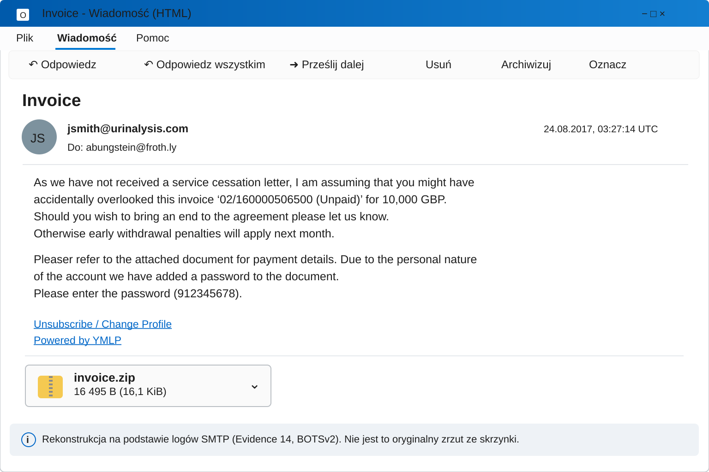

# SOC L1: Wstępna analiza alertu i eskalacja

> Analiza retrospektywna BOTSv2: zdarzenia z 24-26.08.2017, badanie i dokumentacja w listopadzie 2026. Autor korzystał z pomocy AI; wyniki weryfikował w narzędziach. Zalecenia IR nie oznaczają wykonanych działań.

## 1. Alert i klasyfikacja

| Pole | Ustalenie |
| --- | --- |
| Identyfikator alertu | `SOC-DET-001` |
| Nazwa | Podejrzenie spear phishingu: podejrzana dystrybucja załączników ZIP (oryg. *Potential Spear Phishing: Suspicious ZIP Distribution*) |
| Organizacja | Frothly Brewing Company |
| Źródło | Splunk, `index=botsv2`, `sourcetype=stream:smtp` |
| Priorytet | **Średni (Medium)**, do ponownej oceny po sprawdzeniu danych z urządzeń końcowych |
| Data zdarzeń | **24.08.2017, 03:27\:14-03\:27:33 UTC** |
| Osiągnięcie progu | **03:27:29.837 UTC**, trzeci unikalny odbiorca |
| Ocena L1 | **Podejrzenie phishingu** |
| MITRE ATT&CK (wstępne mapowanie) | **T1566.001: Spearphishing Attachment**, taktyka *Initial Access* (uzyskanie dostępu początkowego). Wstępne przypisanie na podstawie wiadomości zachęcającej do otwarcia załącznika ZIP chronionego hasłem. Zawartość archiwum i działania odbiorców wymagają dalszego sprawdzenia. |
| Decyzja | **Eskalacja do SOC L2** |

**Powód alertu:** ten sam nadawca wysłał archiwum ZIP o tej samej nazwie do minimum trzech różnych odbiorców w dziesięciominutowym przedziale. Warunek został spełniony przy trzeciej wiadomości; przeszukanie danych wykazało łącznie cztery wiadomości. Podana godzina osiągnięcia progu wynika z czasu zdarzenia SMTP, nie oznacza czasu podjęcia zgłoszenia przez analityka.

**Rysunek 1. Rekonstrukcja wiadomości „Invoice” na podstawie logów SMTP (Evidence 14).** Zachowano treść i literówkę oryginalnej wiadomości; usunięto techniczne znaki kodowania. Grafika nie jest oryginalnym zrzutem ekranu ze skrzynki pocztowej.

## 2. Podsumowanie zdarzenia (5W1H)

| Pytanie | Ustalenia |
| --- | --- |
| **Kto? (Who)** | Nadawca: `jsmith@urinalysis.com`. Odbiorcy: `abungstein@froth.ly`, `klagerfield@froth.ly`, `btun@froth.ly`, `fyodor@froth.ly`. Rzeczywista tożsamość nadawcy nieustalona. |
| **Co? (What)** | Cztery wiadomości `Invoice` z archiwum `invoice.zip` (16 495 B, zgodny MD5). |
| **Kiedy? (When)** | 24.08.2017, 03:27:14.323-03:27:33.239 UTC; próg osiągnięty o 03:27:29.837 UTC. |
| **Gdzie? (Where)** | Cztery skrzynki pocztowe Frothly; w nagłówku jednej z wiadomości widnieje IP serwera wysyłającego `185.83.51.21`. Nie ustalono, czy odbiorcy otworzyli wiadomości lub załącznik. |
| **Dlaczego podejrzane? (Why)** | Powtarzalna wysyłka ZIP, presja finansowa, hasło w treści maila i brak potwierdzonej zgodności domeny w mechanizmach uwierzytelniania. Motyw sprawcy nieustalony. |
| **Jak? (How)** | Wiadomość o rzekomo zaległej fakturze na 10 000 GBP, z chronionym hasłem załącznikiem ZIP i instrukcją jego otwarcia. |

## 3. Wstępna analiza (triage) i potwierdzone ustalenia

**Zasięg wysyłki.** Każdy z czterech rekordów SMTP zawiera załącznik `invoice.zip` o rozmiarze 16 495 B i MD5 `0fa0f1b660962d4a4d1cd6782a03db05`. Zgodność metadanych silnie wskazuje na dystrybucję tego samego pliku.

| Czas UTC, 24.08.2017 | Odbiorca |
| --- | --- |
| 03:27:14.323 | `abungstein@froth.ly` |
| 03:27:24.557 | `klagerfield@froth.ly` |
| **03:27:29.837** | **`btun@froth.ly`, próg detekcji** |
| 03:27:33.239 | `fyodor@froth.ly` |

**Treść wiadomości.** Nadawca żąda zapłaty rzekomo niezapłaconej faktury na **10 000 GBP** i grozi konsekwencjami finansowymi. W tej samej wiadomości podaje hasło do `invoice.zip`: **`912345678`**. Archiwum chronione hasłem może utrudniać automatyczne sprawdzenie jego zawartości przez systemy pocztowe. Samo podanie hasła w wiadomości nie przesądza jednak o tym, co znajduje się w pliku.

**Nagłówki i filtr pocztowy.** Dla wiadomości do `abungstein@froth.ly` z 03:27:14.323 UTC potwierdzono:

- `SPF=pass` dla domeny technicznej `smtp12.ymlpsvr.com`, IP `185.83.51.21`, ale bez zgodności z widocznym `From: jsmith@urinalysis.com` (brak zgodności domen w SPF (SPF alignment)).
- `DKIM=none` w `Authentication-Results`. Nie potwierdzono poprawnego podpisu DKIM.
- `DMARC=temperror`, czyli błąd tymczasowy, a nie potwierdzenie niepowodzenia weryfikacji (`fail`).
- Microsoft EOP: `SFV:NSPM`, `SCL:1`. Wiadomość nie została uznana przez ten filtr za spam, co nie przesądza o jej bezpieczeństwie.
- Odpowiedź SMTP `250 2.0.0 Ok: queued` i pole `action=delivered`; nie dowodzą przeczytania maila ani otwarcia załącznika.

Wyniki nagłówków dotyczą **jednej** wiadomości i nie zostały automatycznie przypisane pozostałym trzem.

**Reputacja pliku (dodatkowa adnotacja):** VirusTotal: **0/63 wykryć (stan na 11/2026)**. Wynik dotyczy chronionego hasłem kontenera ZIP i nie stanowi dowodu bezpieczeństwa jego zawartości. Nie wykorzystano tej późniejszej obserwacji do uzasadnienia decyzji L1.

**Wcześniejsze wiadomości od tego nadawcy.** W historii poczty znalazłem też wiadomości z 11.08.2017, z tematem `Invoice Doc`. Przy części z nich występuje komunikat `Malware Alert Text.txt`, informujący, że filtr pocztowy usunął załącznik. Na razie nie wiadomo, czy te starsze wiadomości są powiązane z alertem z 24 sierpnia. Warto przekazać tę informację analitykowi L2.

### Wskaźniki związane z alertem (IOC)

| Rodzaj | Wskaźnik | Znaczenie podczas analizy L1 |
| --- | --- | --- |
| Adres nadawcy | `jsmith@urinalysis.com` | Wspólny nadawca czterech podejrzanych wiadomości |
| Załącznik | `invoice.zip`, 16 495 B | Ta sama nazwa i rozmiar we wszystkich czterech zdarzeniach SMTP |
| Hash załącznika | MD5 `0fa0f1b660962d4a4d1cd6782a03db05` | Identyczny hash u czterech odbiorców, przydatny do wyszukania tej samej próbki |
| Temat wiadomości | `Invoice` | Dodatkowy warunek wyszukiwania powiązanych wiadomości; sam temat nie przesądza o phishingu |
| Serwer wysyłający | `185.83.51.21` (`smtp12.ymlpsvr.com`) | Dane z nagłówka jednej wiadomości, przydatne do korelacji; brak podstaw, aby uznać ten serwer za złośliwy |

**Dane pomocnicze do przekazania L2:** cztery adresy odbiorców i czasy wiadomości z tabeli powyżej oraz hasło do archiwum `912345678`. Hasło i adresy odbiorców są ważnym kontekstem sprawy, ale nie stanowią samodzielnych wskaźników złośliwości.

## 4. Ocena L1 i decyzja

**Decyzja: eskalacja do SOC L2.** Nietypowa wysyłka tego samego archiwum do czterech odbiorców, próba wywarcia presji finansowej oraz niejednoznaczne wyniki weryfikacji nadawcy uzasadniają dalszą analizę wiadomości i załącznika. Priorytet: **średni (Medium)**; ewentualna zmiana wymaga dalszej oceny.

**Nadal nie wiadomo:** czy odbiorcy przeczytali wiadomości i czy próbowali pobrać, rozpakować lub otworzyć załącznik `invoice.zip`. Nie znamy też zawartości archiwum. Te kwestie wymagają dalszego sprawdzenia.

## 5. Wykonane czynności i dalsze działania

| Czynność | Status |
| --- | --- |
| Weryfikacja czterech zdarzeń SMTP, progu i adresatów | **Wykonano** |
| Sprawdzenie treści, hasła, metadanych załącznika i nagłówków jednej wiadomości | **Wykonano** |
| Zebranie IOC i sprawdzenie wcześniejszych zdarzeń nadawcy | **Wykonano** |
| Kwarantanna lub usunięcie wiadomości z poczty | **Do oceny przez uprawniony zespół poczty** |
| Ustalenie, czy odbiorcy otworzyli wiadomości lub załącznik | **Do wyjaśnienia przez L2** |
| Ewentualne działania ochronne dotyczące wiadomości i załącznika | **Do decyzji uprawnionego zespołu** |

Nie odnotowano wykonania kwarantanny wiadomości ani blokad na etapie wstępnej analizy.

## 6. Przekazanie sprawy do SOC L2

**Dane do przekazania:** IOC zestawione w sekcji 3, cztery adresy odbiorców i czasy wiadomości oraz hasło do archiwum `912345678`.

**Uzasadnienie eskalacji:** ustalone informacje wskazują na możliwy phishing, ale analiza L1 nie pozwala ocenić zawartości załącznika ani ustalić, czy odbiorcy próbowali go otworzyć. Do dalszego wyjaśnienia pozostają również starsze wiadomości od tego samego nadawcy (11.08.2017). Przekazuję wyniki wstępnej analizy, dane wiadomości i załącznika oraz zebrane dowody do dalszego sprawdzenia.

## 7. Odwołania do dowodów (Evidence)

- **Evidence 07-08:** dystrybucja wiadomości i próg detekcji.
- **Evidence 12A-14:** nagłówki, antyspam i treść wiadomości z hasłem.
- **Evidence 15:** nazwa, rozmiar i MD5 załącznika.
- **Evidence 16:** dodatkowy wynik reputacji pliku, datowany na 11/2026.
- **Evidence 09-11:** wcześniejsza aktywność nadawcy z 11.08.

Pełne zapytania SPL oraz uwagi dotyczące konstrukcji detekcji są dostępne w oddzielnym załączniku technicznym.

[
Załącznik techniczny \| SOC-DET-001 SPL i ograniczenia detekcji
](../technical/soc-l1-spl.md)
