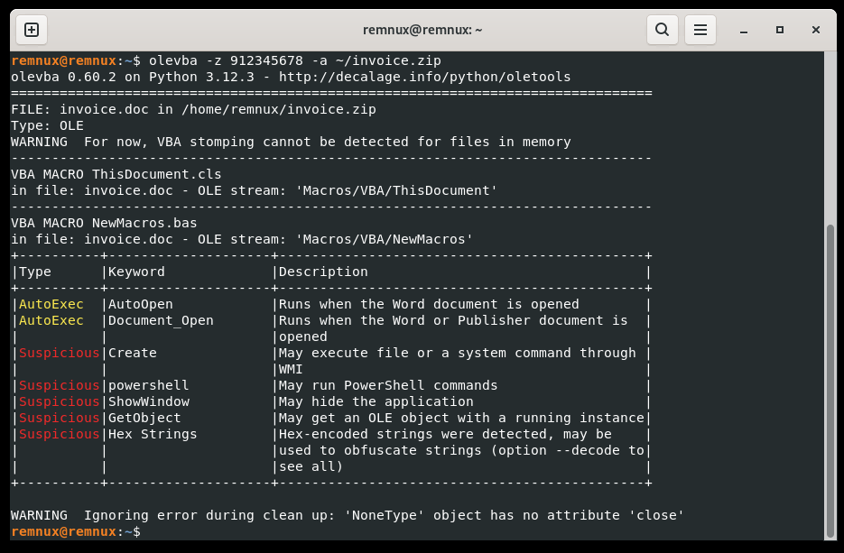
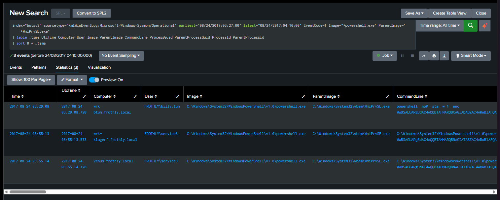
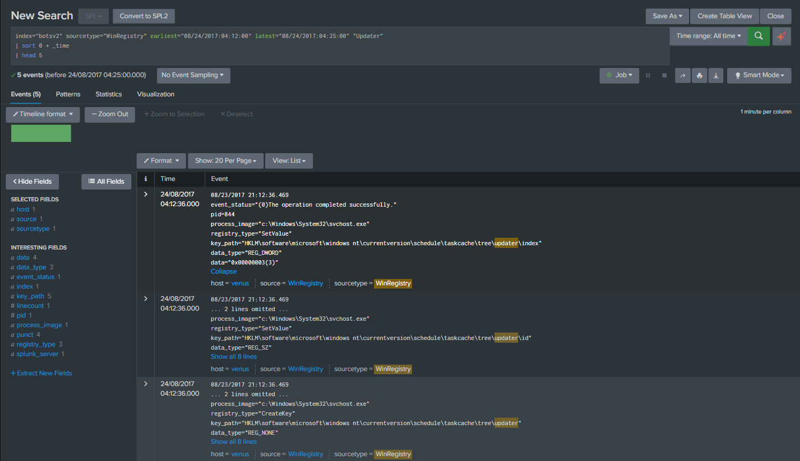
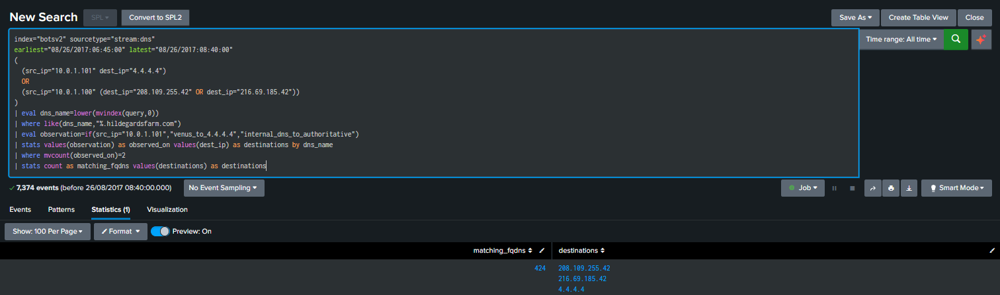

# SOC L2: Raport z analizy incydentu

> Analiza retrospektywna BOTSv2: zdarzenia z 24-26.08.2017, badanie i dokumentacja w listopadzie 2026. Autor korzystał z pomocy AI; wyniki weryfikował w narzędziach. Zalecenia IR nie oznaczają wykonanych działań.

## 1. Podsumowanie sprawy

| Pole | Ustalenie |
| --- | --- |
| Identyfikator sprawy | `SOC-DET-001` |
| Organizacja | Frothly Brewing Company |
| Źródło zgłoszenia | Eskalacja z SOC L1: podejrzane wiadomości `Invoice` z `invoice.zip` |
| Okres incydentu | 24-26 sierpnia 2017 r., UTC |
| Klasyfikacja L2 | **True Positive: potwierdzona złośliwa aktywność** |
| Kategoria incydentu | Phishing z załącznikiem, uruchomienie złośliwego skryptu, podejrzenie nieautoryzowanego przesyłania danych |
| Priorytet | **Wysoki (High)**, ocena analityczna wynikająca z ustalonego zakresu i ryzyka |
| Hosty z potwierdzonym WMI → PowerShell | `wrk-btun`, `wrk-klagerf`, `venus` |
| Decyzja | **Zalecana pilna eskalacja do zespołu reagowania na incydenty (IR)**, zabezpieczenie materiału dowodowego i dalsza ocena skutków |

Sprawa trafiła do L2 po wykryciu czterech wiadomości z załącznikiem `invoice.zip`. W archiwum znajdował się dokument Word `invoice.doc` ze złośliwymi makrami VBA. Ich zadaniem było uruchomienie zakodowanego polecenia PowerShell przez WMI. W logach Sysmon znaleziono ślady takiego uruchomienia na **trzech komputerach Frothly**.

Na `venus` potwierdzono także połączenia PowerShell z podejrzanym adresem IP i ślady mechanizmu pozwalającego uruchamiać kod ponownie. Pozostałe logi ujawniły pobieranie narzędzi przez FTP, wysyłanie plików na zewnętrzny serwer oraz nietypowy ruch DNS. Skala tych zdarzeń uzasadnia zmianę priorytetu ze średniego (**Medium**) na wysoki (**High**).

## 2. Zakres analizy i źródła danych

Po eskalacji z L1 analiza skupiła się na trzech kwestiach: **zawartości załącznika, śladach jego działania na komputerach oraz dalszej aktywności w sieci**.

Sprawdzono logi pocztowe, zdarzenia Sysmon, rejestr Windows oraz ruch sieciowy zapisany w Splunk. Kluczowe źródła to `stream:smtp`, `XmlWinEventLog:Microsoft-Windows-Sysmon/Operational`, `WinRegistry`, `stream:tcp`, `stream:ftp`, `stream:dns` i `pan:traffic`. Sam dokument i makra zbadano w odizolowanym środowisku.

## 3. Najważniejsze ustalenia

### 3.1. Załącznik zawiera złośliwe makra

Archiwum `invoice.zip` ma **16 495 bajtów** i MD5 `0fa0f1b660962d4a4d1cd6782a03db05`. Po użyciu hasła podanego w wiadomości uzyskano dokument `invoice.doc`, SHA-256 `d8834aaa5ad6d8ee5ae71e042aca5cab960e73a6827e45339620359633608cf1`.

Statyczna analiza VBA wykazała dwa punkty uruchomienia: `AutoOpen` i `Document_Open`. Oba odwołują się do funkcji `Debugging`, która składa polecenie PowerShell z wielu fragmentów, a następnie wywołuje `Win32_Process.Create` przez WMI. W efekcie nowy proces PowerShell może zostać uruchomiony przez `WmiPrvSE.exe`, zamiast bezpośrednio przez Worda.

Odkodowany skrypt próbuje ograniczyć działanie AMSI i kontroli certyfikatów TLS. Zawiera też instrukcje pobierania, odszyfrowywania i wykonywania kolejnego fragmentu kodu. Wskazuje na `45.77.65.211:443` oraz ścieżki `/login/process.php` i `/admin/get.php`, zależnie od wariantu. Obecność takich instrukcji w próbce **nie dowodzi jeszcze, że kolejny etap został skutecznie pobrany**.

*Rysunek 1. Analiza statyczna `invoice.doc` narzędziem `olevba`: wykryte makra AutoExec oraz podejrzane funkcje PowerShell i WMI. Evidence 20A.*

### 3.2. Ślady uruchomienia na trzech hostach

W Sysmon Event ID 1 potwierdzono uruchomienie `powershell.exe` przez `WmiPrvSE.exe`:

| Host | Adres IP | Pierwsze istotne zdarzenie, 24.08 UTC |
| --- | --- | --- |
| `wrk-btun.frothly.local` | `10.0.2.107` | 03:29:08 |
| `wrk-klagerf.frothly.local` | `10.0.2.109` | 03:55:13 |
| `venus.frothly.local` | `10.0.1.101` | 03:55:14.728 |

Wszystkie trzy zdarzenia zawierają charakterystyczne wywołania zakodowanego PowerShell. **Potwierdzają uruchomienie podejrzanych procesów**, ale same w sobie nie wskazują, kto otworzył załącznik. Liczby czterech odbiorców wiadomości nie należy utożsamiać z liczbą zainfekowanych komputerów.

*Rysunek 2. Sysmon Event ID 1: procesy `WmiPrvSE.exe → powershell.exe` na trzech stacjach. Evidence 23F.*

Na `venus` Sysmon Event ID 3 zarejestrował o **03:55:25 UTC** próbę połączenia TCP do `45.77.65.211:443`. Zgodny `ProcessGuid` łączy to zdarzenie z wcześniej uruchomionym PowerShell. **Potwierdzono więc aktywność sieciową konkretnego procesu**. Nie potwierdzono, czy doszło do skutecznego pobrania kolejnego etapu z tego serwera.

### 3.3. Persistence na `venus`: zadanie `Updater` i wartość `debug`

O **04:12:36 UTC** PowerShell uruchomił polecenie tworzące codzienne zadanie harmonogramu o nazwie `Updater`, zaplanowane na godzinę **10:51** z kontem `SYSTEM`. Oddzielne zdarzenia rejestru potwierdziły pojawienie się `TaskCache\Tree\Updater`.

W tym samym czasie w `HKLM\Software\Microsoft\Network\debug` zapisano zakodowany skrypt PowerShell. Akcja zadania `Updater` odwoływała się do tej wartości, aby odczytać i wykonać kod. Taki układ wskazuje na próbę **utrzymywania dostępu (persistence)**.

Potwierdzono **rejestrację zadania i zapis danych w rejestrze**, ale nie późniejsze wykonanie zadania o 10:51 ani jego działanie po restarcie komputera.

*Rysunek 3. Rejestracja zadania `Updater` w `TaskCache`. Evidence 24I; zapis wartości `debug` potwierdza Evidence 24K.*

### 3.4. Transfery FTP i ryzyko ujawnienia plików

**24 sierpnia** serwer FTP `160.153.91.7:21` potwierdził **14 udanych pobrań (`RETR`)**, po siedem z `wrk-btun` i `wrk-klagerf`. W obu zestawach wystąpiły te same nazwy narzędzi, w tym `dns.py`, `nc.exe`, `psexec.exe`, instalator Pythona i `wget64.exe`. Samo pobranie nie dowodzi, że każde narzędzie uruchomiono.

**26 sierpnia** w logach FTP zarejestrowano **711 poleceń wysyłania plików (`STOR`)** na ten sam serwer: **707 udanych transferów, 2 przerwane i 2 bez rozstrzygniętego wyniku**. Z adresu `wrk-klagerf` zakończył się powodzeniem transfer pliku `frothly_passwords.kdbx` o **05:28:25.089 UTC**. Z `wrk-btun` potwierdzono **706 udanych operacji STOR**, dotyczących nazw plików PDF, wśród których występowały również powtórzenia.

Te transfery oznaczają **wysokie ryzyko ujawnienia danych**. Ocenę rzeczywistych skutków utrudnia brak zawartości przesłanych plików i informacji o uprawnieniach do serwera FTP. Nie ustalono też, czy baza KeePass została otwarta lub odszyfrowana. **Przerwany transfer `topsecretyeast.pdf` nie jest liczony jako udany.**

W telemetrii występuje także `ftp.exe -i -s:winsys32.dll` lub `winsys64.dll`. Parametr `-s:` wskazuje tu **plik z poleceniami dla klienta FTP**. Nie jest to samodzielny dowód wstrzyknięcia lub uruchomienia biblioteki DLL.

### 3.5. Nietypowe zapytania DNS

**26 sierpnia** host `venus` wysyłał wiele zapytań do subdomen `hildegardsfarm.com`, zawierających zakodowane fragmenty danych. W badanym okresie **06:50\:20-07\:09:59 UTC** stwierdzono **1857 unikalnych pełnych nazw domenowych**. Po dekodowaniu części nazw odkryto numery kolejnych fragmentów i dane binarne, w tym fragment zgodny ze strukturą JPEG/JFIF.

Porównanie dwóch źródeł logów wykazało **424 identyczne pełne nazwy DNS**: w ruchu z `venus` oraz w zapytaniach wychodzących z wewnętrznego DNS do serwerów autorytatywnych. To silny dowód, że zakodowane fragmenty danych były widoczne również poza hostem źródłowym. Dostępne fragmenty nie wystarczają jednak do odtworzenia całego pliku.

Na `venus` znaleziono także uruchomienie `python.exe dns.py` o **06:50:54 UTC**, poprzedzone próbą instalacji `python.msi`. Pierwsze zdarzenia DNS mają jednak czas około **34 sekund wcześniejszy** niż start tego procesu w Sysmon. Nie można więc przypisać każdego zapytania konkretnemu procesowi wyłącznie na podstawie czasu.

*Rysunek 4. Korelacja 424 identycznych nazw DNS w dwóch punktach obserwacji. Evidence 25BF.*

## 4. Zakres incydentu i krótka oś czasu

| Host | Najważniejsze potwierdzone zachowania | Ocena L2 |
| --- | --- | --- |
| `wrk-btun` (`10.0.2.107`) | WMI → PowerShell, pobrania FTP, liczne udane wysyłki FTP | Złośliwa aktywność i poważne ryzyko ujawnienia danych |
| `wrk-klagerf` (`10.0.2.109`) | WMI → PowerShell, pobrania FTP, udany transfer `frothly_passwords.kdbx` | Złośliwa aktywność, ryzyko ujawnienia magazynu poświadczeń |
| `venus` (`10.0.1.101`) | WMI → PowerShell, połączenia do `45.77.65.211:443`, `Updater`, `debug`, anomalne DNS | Złośliwa aktywność, persistence i podejrzenie eksfiltracji przez DNS |

Wykryto **czterech adresatów wiadomości**, ale ślady wykonania charakterystycznych procesów dotyczą **trzech hostów**. Nie zakładamy automatycznie, że czwarty odbiorca uruchomił plik.

| Data i godzina UTC | Zdarzenie | Dowód |
| --- | --- | --- |
| 24.08, 03:27\:14-03\:27:33 | Cztery wiadomości `Invoice` z `invoice.zip` | Evidence 07, 15 |
| 24.08, 03:29:08 | WMI → PowerShell na `wrk-btun` | Evidence 23F |
| 24.08, 03:55\:13-03\:55:14 | WMI → PowerShell na `wrk-klagerf` i `venus` | Evidence 23F |
| 24.08, 03:55:25 | PowerShell na `venus` inicjuje połączenie do `45.77.65.211:443` | Evidence 24A |
| 24.08, 04:12:36 | Zadanie `Updater` i wartość rejestru `debug` na `venus` | Evidence 24I, 24K |
| 26.08, 05:28:25 | Udany transfer `frothly_passwords.kdbx` | Evidence 25AT |
| 26.08, 05\:41-06\:35 | Liczne udane transfery PDF z `wrk-btun` | Evidence 25AT |
| 26.08, 06\:50-07\:09 | Zakodowane zapytania DNS z `venus` | Evidence 25P, 25BF |

Czasy pochodzą z różnych źródeł telemetrycznych. Zauważone przesunięcia czasowe pomiędzy Stream a Sysmon ograniczają możliwość przypisania konkretnych transferów sieciowych do pojedynczego procesu tylko na podstawie zbliżonej godziny.

### Wskaźniki związane z incydentem (IOC)

| Typ | Wskaźnik | Znaczenie w sprawie | Dowód |
| --- | --- | --- | --- |
| **Domena** | `hildegardsfarm.com` | Podejrzana domena powiązana z ruchem DNS i historyczną odpowiedzią wskazującą adres serwera FTP | Evidence 25AV, 25BF |
| Wzorzec DNS | `*.hildegardsfarm.com` | Liczne subdomeny zawierały zakodowane fragmenty danych; 424 identyczne nazwy zaobserwowano w dwóch grupach ruchu | Evidence 25P, 25BF |
| Adres IP / FTP | `160.153.91.7:21` | Serwer, z którego pobierano narzędzia i na który wysyłano pliki | Evidence 25AS, 25AT |
| Adres IP / HTTPS | `45.77.65.211:443` | Cel połączenia inicjowanego przez podejrzany proces PowerShell na `venus` | Evidence 24A |
| Adres nadawcy | `jsmith@urinalysis.com` | Adres widoczny w podejrzanych wiadomościach `Invoice` | Evidence 07, 12A |
| Hash załącznika | MD5 `0fa0f1b660962d4a4d1cd6782a03db05` | Identyfikacja archiwum `invoice.zip` | Evidence 15, 17A |
| Hash dokumentu | SHA-256 `d8834aaa5ad6d8ee5ae71e042aca5cab960e73a6827e45339620359633608cf1` | Identyfikacja złośliwego dokumentu `invoice.doc` | Analiza próbki (§31) |

Domena i powiązany z nią adres IP są istotnymi wskaźnikami do dalszego wyszukiwania zdarzeń. Ich obecność w logach nie rozstrzyga jednak, kto zarządzał tą infrastrukturą.

## 5. Ocena zagrożenia

**Klasyfikacja: True Positive. Priorytet: wysoki (High).**

Priorytet wynika z trzech czynników:

| Kryterium | Uzasadnienie |
| --- | --- |
| **Zasięg** | Potwierdzone uruchomienie podejrzanych procesów na trzech hostach, w tym mechanizm `Updater/debug` na `venus`. |
| **Potencjalny wpływ** | 707 udanych transferów plików przez FTP, w tym plik `frothly_passwords.kdbx` sugerujący magazyn poświadczeń; nie ustalono zawartości ani poufności plików. |
| **Pilność** | Komunikacja procesu PowerShell z podejrzanym adresem, ślady utrzymywania dostępu i zapytania DNS przenoszące zakodowane fragmenty danych. |

Łącznie uzasadniają one **wysoki priorytet (High)** i pilną eskalację do IR.

**Do dalszego wyjaśnienia** pozostają przede wszystkim zawartość wysłanych plików, możliwość wykorzystania poświadczeń, faktyczna kontrola nad serwerem FTP oraz późniejsze działanie zadania `Updater`. Zakres tych niewiadomych nie zmienia oceny ryzyka.

## 6. MITRE ATT&CK: najważniejsze techniki

Poniżej wybrano techniki opisujące zachowania istotne dla obsługi incydentu. Pełne mapowanie i poziomy potwierdzenia znajdują się w raporcie DFIR.

| Technika | Obserwacja |
| --- | --- |
| `T1566.001` Spearphishing Attachment | Podejrzane wiadomości z `invoice.zip` i złośliwym `invoice.doc` |
| `T1059.005` Visual Basic | Makra VBA `AutoOpen` / `Document_Open` i skrypt VBS |
| `T1047` Windows Management Instrumentation | Uruchomienie PowerShell przez `WmiPrvSE.exe` |
| `T1059.001` PowerShell | Zakodowane polecenia i uruchomienie procesów |
| `T1053.005` Scheduled Task | Rejestracja zadania `Updater` |
| `T1112` Modify Registry | Zapis wartości `debug` |
| `T1105` Ingress Tool Transfer | Udane pobrania `RETR` przez FTP |
| `T1048.003` Exfiltration Over Unencrypted Non-C2 Protocol | Operacje `STOR` i zakodowane fragmenty w zapytaniach DNS; pełne skutki nadal wymagają oceny |

Mapowanie opisuje zaobserwowane techniki i ocenę ich prawdopodobnego celu, a nie wszystkie możliwe skutki incydentu.

## 7. Zalecenia dla zespołu reagowania na incydenty

Na podstawie analizy wskazano działania, które powinien rozważyć zespół reagowania na incydenty (IR).

| Priorytet | Zalecane działanie | Powód | Dalszy krok |
| --- | --- | --- | --- |
| Pilny | Rozważyć izolację `wrk-btun`, `wrk-klagerf` i `venus`, uwzględniając zabezpieczenie dowodów | Na trzech komputerach wykryto podejrzane procesy | Decyzja IR |
| Pilny | Sprawdzić i ograniczyć nieautoryzowany ruch do `45.77.65.211:443` oraz `160.153.91.7:21` | Połączenia do podejrzanego adresu i transfery plików | Decyzja IR |
| Pilny | Ustalić zawartość `frothly_passwords.kdbx` i ocenić konieczność zmiany zagrożonych haseł | Udany transfer pliku mogącego zawierać bazę poświadczeń | Weryfikacja i decyzja IR |
| Wysoki | Zabezpieczyć dane związane z `Updater`, `debug`, PowerShell i zdarzeniami systemowymi | Mogą pomóc ustalić dalszą aktywność na hostach | Zabezpieczenie materiału |
| Wysoki | Ustalić rodzaj przesłanych dokumentów i przeanalizować ruch `*.hildegardsfarm.com` | Ryzyko utraty danych przez FTP i DNS | Dalsza analiza |
| Wysoki | Rozważyć detekcje WMI → zakodowany PowerShell, podejrzanych zadań, transferów FTP i nietypowych nazw DNS | Możliwość wcześniejszego wykrycia podobnego incydentu | Doskonalenie monitoringu |

> **Jak wyglądałoby postępowanie podczas trwającego incydentu?**
>
> Najpierw należałoby sprawdzić, czy trzy wskazane komputery nadal wykazują podejrzaną aktywność. Jeżeli trwałaby komunikacja z zewnętrznymi adresami lub przesyłanie danych, priorytetem byłoby jej szybkie ograniczenie. SOC L2 przekazałby zespołowi IR listę hostów, adresów IP i zdarzeń, na których oparto ocenę.
>
> Dalsze kroki obejmowałyby izolację komputerów, zabezpieczenie dostępnych śladów, wyszukanie podobnych wiadomości w poczcie i ocenę ryzyka dla haseł przechowywanych w `frothly_passwords.kdbx`. Po ograniczeniu aktywności trzeba byłoby sprawdzić, czy ustały podejrzane połączenia i czy nie pojawiają się kolejne uruchomienia złośliwych skryptów. Zakres tych działań zależałby od procedur firmy i decyzji zespołu IR.

### Wnioski operacyjne

- Warto wykrywać uruchamianie zakodowanego PowerShell przez WMI i zestawiać takie zdarzenia z późniejszym ruchem sieciowym.
- Nowe zadania harmonogramu, które odczytują skrypty z rejestru, powinny zwracać uwagę analityków.
- Masowe transfery FTP i nietypowe, długie subdomeny DNS wymagają monitorowania. Reguły należy jednak przetestować, aby ograniczyć fałszywe alarmy.

## 8. Przekazanie do IR / DFIR

**Do dalszego ustalenia:** zawartość przesłanych dokumentów i ewentualna ekspozycja poświadczeń; pochodzenie i kontrola zewnętrznego FTP; pełna zawartość skryptu `dns.py`; brakujące fragmenty danych DNS; rzeczywiste wykonanie zadania `Updater` oraz pełny zasięg zdarzenia.

**Najważniejsze artefakty do przekazania:** IOC, w tym `hildegardsfarm.com`, wzorzec `*.hildegardsfarm.com`, adresy `160.153.91.7:21` i `45.77.65.211:443`, hashe próbki, zwięzła oś czasu, identyfikatory `ProcessGuid` i odpowiadające im Sysmon Event ID 1/3, zapisy `TaskCache` i `debug`, logi FTP z odpowiedziami serwera oraz wyniki porównania nazw DNS. Szczegółowe eksporty i zapytania SPL są udokumentowane w Evidence Journal.

**Priorytet przekazania:** pilny, ze względu na możliwość dalszych transferów danych i utrzymywania dostępu na `venus`.

## 9. Materiał dowodowy

**Pochodzenie materiału.** Analizę oparto na logach poczty, Sysmon, rejestru Windows, FTP, DNS i zapory sieciowej z BOTSv2. Próbkę `invoice.zip` odzyskano z wiadomości, a jej hash porównano z metadanymi załącznika. Kod makr sprawdzono w izolowanym środowisku. Wyniki analiz, wybrane eksporty i zrzuty ekranu są opisane w dzienniku dowodowym.

**Integralność materiału.** Archiwum `invoice.zip`: MD5 `0fa0f1b660962d4a4d1cd6782a03db05`, SHA-256 `01c5ea93f845b8f993007e6371a3d7ef511831a165e558485b42afabd71377cd`. Dokument `invoice.doc`: SHA-256 `d8834aaa5ad6d8ee5ae71e042aca5cab960e73a6827e45339620359633608cf1`. Materiał obejmuje logi i odzyskaną próbkę, bez obrazów dysków i pamięci badanych komputerów.

Źródło szczegółowych zapytań i artefaktów: [Wykaz dowodów](../evidence/evidence-matrix.md).

- **Analiza próbki:** Evidence 17C-17F, 18, 20A-20C (§28-31).
- **Uruchomienie i komunikacja:** Evidence 23E-23G, 24A (§35-36).
- **Utrzymywanie dostępu:** Evidence 24E, 24I, 24K (§38-41).
- **FTP:** Evidence 25AS, 25AT, 25AW-25AZ (§88-95).
- **DNS:** Evidence 25M, 25P, 25Y, 25BD-25BF (§55-66, §99-101).
- **Ocena zakresu i chronologia:** §102, §104-105.
