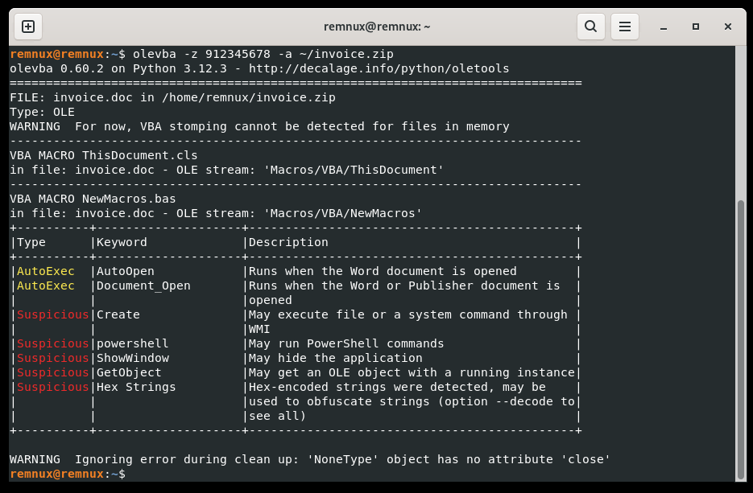
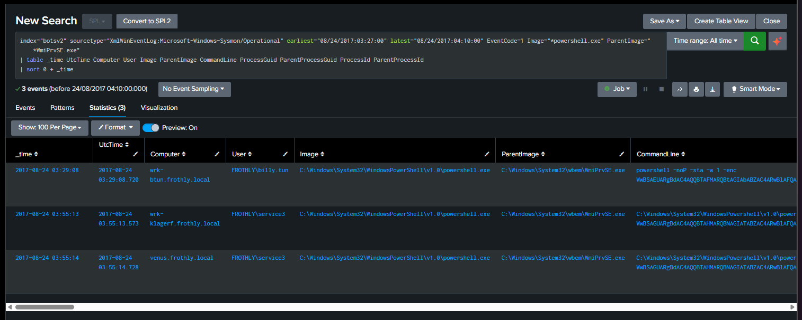
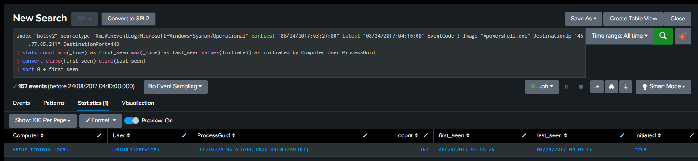
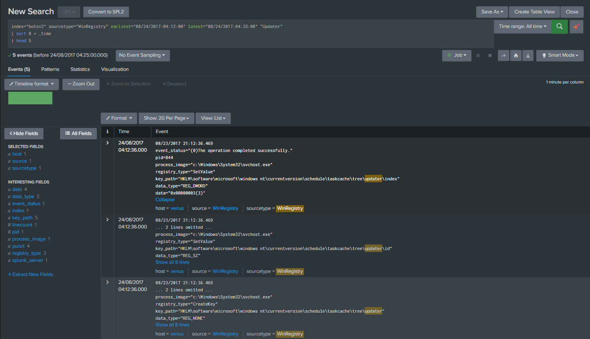
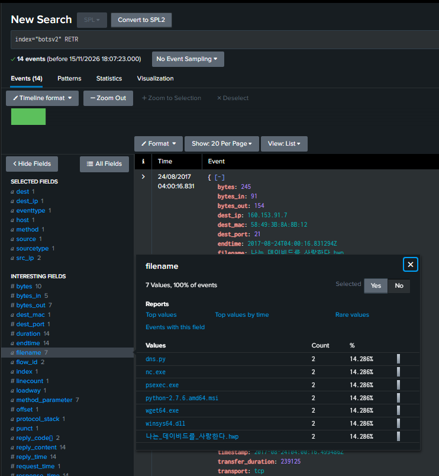
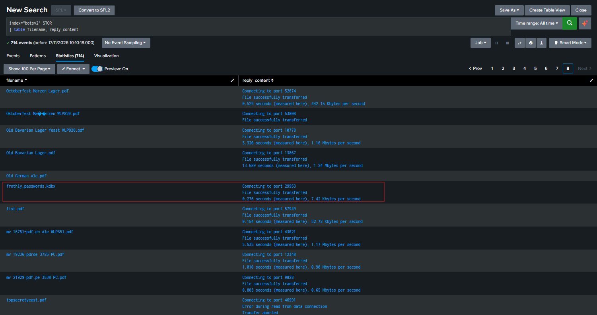
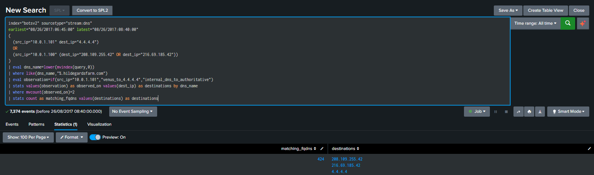

# DFIR: Od phishingu do próby wyniesienia danych

> Analiza retrospektywna BOTSv2: zdarzenia z 24-26.08.2017, badanie i dokumentacja w listopadzie 2026. Autor korzystał z pomocy AI; wyniki weryfikował w narzędziach. Zalecenia IR nie oznaczają wykonanych działań.

*Raport końcowy z analizy incydentu w środowisku Frothly Brewing Company.*

| Informacja | Ustalenie |
| --- | --- |
| Sprawa | `SOC-DET-001`, alert odtworzony na potrzeby analizy BOTSv2 |
| Okres zdarzeń | 24-26 sierpnia 2017 r. |
| Źródło danych | Splunk Boss of the SOC v2 |
| Werdykt | **True Positive, priorytet wysoki (High)** |
| Zakres | Trzy hosty z potwierdzonym wykonaniem podejrzanych procesów |
| Stan dochodzenia | Zakończono ocenę dostępnej telemetrii; pozostają zagadnienia wymagające weryfikacji przez IR |

## 1. Co ustalono?

Punktem wyjścia były cztery wiadomości z tematem `Invoice`, zaadresowane do czterech odbiorców we Frothly i zarejestrowane w logach SMTP w ciągu około 19 sekund. Każda zawierała to samo archiwum `invoice.zip`. Treść wiadomości sugerowała zaległą płatność i nakłaniała do otwarcia chronionego hasłem dokumentu. Sam alert pocztowy uzasadniał podejrzenie phishingu, ale nie mówił jeszcze nic o tym, co działo się później na komputerach.

Analiza archiwum pokazała, że w środku znajduje się dokument Word ze złośliwymi makrami. Powiązane z nimi zachowanie udało się następnie znaleźć w logach Sysmon na trzech hostach: `wrk-btun`, `wrk-klagerf` i `venus`. Widać tam uruchomienie zakodowanych poleceń PowerShell przez WMI. Na `venus` pojawił się dodatkowo mechanizm utrzymywania dostępu, złożony z zadania `Updater` i skryptu zapisanego w rejestrze.

Najpoważniejsze ustalenia dotyczą jednak dalszych transferów. Dwa hosty pobierały narzędzia z zewnętrznego serwera FTP, a dwa dni później wysyłały na niego pliki. **Serwer potwierdził 707 udanych operacji wysyłania**, w tym pliku nazwanego `frothly_passwords.kdbx`. Niezależnie od tego `venus` generował nietypowe zapytania DNS do subdomen `hildegardsfarm.com`. Nazwy te przenosiły uporządkowane fragmenty danych, a część identycznych nazw odnaleziono również w drugim punkcie obserwacji ruchu.

**Końcowa ocena: potwierdzono złośliwą aktywność na trzech hostach, mechanizm persistence na jednym z nich, udane transfery plików poza sieć i silne oznaki dodatkowego wynoszenia fragmentów danych przez DNS.** Nie ustalono pełnej zawartości przesłanych plików ani tego, kto faktycznie zarządzał zewnętrzną infrastrukturą. Ten brak nie zmienia wysokiego priorytetu incydentu, ale wyznacza granice oceny jego skutków.

## 2. Jak prowadzono dochodzenie?

Analiza zaczęła się od wiadomości SMTP, następnie objęła zawartość załącznika, zdarzenia procesów w Sysmon i ruch sieciowy. Wyniki z jednego źródła sprawdzano w drugim. Przykładowo sposób uruchamiania kodu znaleziony w makrze zestawiono z drzewem procesów Windows, a ruch do podejrzanego adresu IP powiązano z konkretną instancją PowerShell przez `ProcessGuid`.

Wykorzystano logi `stream:smtp`, Sysmon, `WinRegistry`, zdarzenia Windows Security, `stream:tcp`, `stream:ftp`, `stream:dns` i `pan:traffic`. Próbkę badano statycznie w REMnux, a zakodowane fragmenty analizowano także w CyberChef. Wyniki z [ANY.RUN](https://any.run/) i [tria.ge](https://tria.ge/) służyły do lepszego zrozumienia zachowania próbki, nie jako zamiennik historycznych zdarzeń z endpointów.

To ważne rozróżnienie: **incydent rozegrał się w 2017 r., natomiast analiza laboratoryjna została przeprowadzona w listopadzie 2026 r.** Raport dotyczy przede wszystkim logów i odzyskanych artefaktów. Nie obejmuje pełnego obrazowania dysków ani pamięci hostów, więc nie zastępuje kompletnego badania nośników.

## 3. Jak rozwijał się incydent?

### 3.1. Wiadomość wyglądała jak przypomnienie o płatności

24 sierpnia między 03:27:14.323 a 03:27:33.239 UTC w logach SMTP zarejestrowano cztery wiadomości od `jsmith@urinalysis.com`. Odbiorcami byli `abungstein@froth.ly`, `klagerfield@froth.ly`, `btun@froth.ly` i `fyodor@froth.ly`. Wszystkie rekordy zawierały archiwum `invoice.zip` o rozmiarze 16 495 bajtów i tym samym MD5: `0fa0f1b660962d4a4d1cd6782a03db05` (Evidence 07, 14, 15).

Nadawca wspominał o niezapłaconej fakturze na 10 000 GBP i możliwych karach. Hasło do archiwum, `912345678`, znajdowało się w samej wiadomości. Taka konstrukcja mogła skłonić odbiorcę do ręcznego otwarcia dokumentu, jednocześnie utrudniając automatyczne badanie chronionego hasłem ZIP-a.

Na tym etapie można było potwierdzić kampanię pocztową, ale nie jej skuteczność. O tym, że sprawa wykracza poza sam phishing, zdecydowały dopiero kolejne ślady.

### 3.2. Dokument Word uruchamiał PowerShell przez WMI

Po rozpakowaniu `invoice.zip` odzyskano dokument `invoice.doc`. Analiza jego kodu VBA wykazała makra `AutoOpen` i `Document_Open`. Oba prowadziły do funkcji `Debugging()`, która składała polecenie PowerShell z 58 fragmentów i uruchamiała je przez `Win32_Process.Create` w WMI.

To tłumaczy, dlaczego w logach procesu rodzicem PowerShell mógł być `WmiPrvSE.exe`, a nie bezpośrednio Word. Odkodowany skrypt zawierał także próbę ograniczenia działania AMSI i weryfikacji certyfikatów TLS oraz kod służący do pobierania i uruchamiania kolejnego etapu. Warianty downloadera odwoływały się do `45.77.65.211:443`, korzystając ze ścieżek `/login/process.php` i `/admin/get.php`. Potwierdzono działanie zapisane w próbce; sukces pobrania kolejnego etapu pozostaje odrębnym pytaniem (Evidence 17C-17F, §31).

*Rysunek 1. Analiza makr w `invoice.doc` narzędziem `olevba`. Evidence 20A.*

Kluczowe było sprawdzenie, czy opisany mechanizm wystąpił także poza laboratorium. W Sysmon Event ID 1 znaleziono odpowiadające mu uruchomienia `WmiPrvSE.exe → powershell.exe -enc` na trzech komputerach:

| Host | Adres IP | Pierwsze istotne zdarzenie, 24.08 UTC |
| --- | --- | --- |
| `wrk-btun` | `10.0.2.107` | 03:29:08 |
| `wrk-klagerf` | `10.0.2.109` | 03:55:13 |
| `venus` | `10.0.1.101` | 03:55:14.728 |

*Rysunek 2. Uruchomienia PowerShell przez WMI na trzech hostach. Evidence 23F.*

Nie ma potrzeby zakładać, że wszystkie cztery osoby otrzymujące e-mail otworzyły załącznik. W danych widać **trzy hosty z wykonaniem charakterystycznych procesów**, a nie cztery potwierdzone interakcje użytkowników z dokumentem.

### 3.3. Komunikacja sieciowa i mechanizm persistence na `venus`

Na `venus` ta sama instancja PowerShell, rozpoznana po `ProcessGuid`, o 03:55:25 UTC zainicjowała połączenie TCP do `45.77.65.211:443`. Potwierdza to Sysmon Event ID 3 (Evidence 24A). Dzięki identyfikatorowi procesu można połączyć wykonanie kodu z późniejszą próbą komunikacji sieciowej, a nie opierać się jedynie na zgodności adresu hosta i czasu.

*Rysunek 3. Zdarzenie sieciowe powiązane z konkretną instancją PowerShell. Evidence 24A/24B.*

Kolejny ślad pojawił się o 04:12:36 UTC. PowerShell uruchomił `schtasks.exe` z parametrami tworzenia zadania `Updater`, które miało działać codziennie jako `SYSTEM`. Osobne zdarzenia `WinRegistry` pokazały rejestrację zadania w `TaskCache\Tree\Updater` oraz zapis zakodowanego skryptu w wartości `HKLM\Software\Microsoft\Network\debug`.

W tym przypadku sam proces `schtasks.exe` nie byłby jeszcze wystarczającym dowodem. Dopiero zestawienie go z wpisami rejestru pokazało, że mechanizm rzeczywiście został zarejestrowany. `Updater` miał później odczytywać kod z wartości `debug` i uruchamiać go. **Potwierdzono utworzenie artefaktów persistence**, ale nie późniejsze wykonanie zadania zgodnie z harmonogramem (Evidence 24E, 24I, 24K).

*Rysunek 4. Rejestracja zadania `Updater` w TaskCache. Evidence 24I.*

### 3.4. FTP: najpierw pobrano narzędzia, potem wysyłano pliki

W danych z 24 sierpnia pojawia się kolejny element łańcucha. `wrk-btun` i `wrk-klagerf` połączyły się z serwerem FTP `160.153.91.7:21`. Każda stacja pobrała siedem plików. Wśród nazw były `dns.py`, `nc.exe`, `psexec.exe`, instalator Pythona, `wget64.exe`, `winsys64.dll` i dokument `.hwp`. Wszystkie 14 operacji `RETR` zakończyło się komunikatem serwera `File successfully transferred` (Evidence 25AS).

*Rysunek 5. Wynik wyszukiwania pokazuje 14 żądań `RETR` i nazwy plików. Sam zrzut nie potwierdza sukcesu wszystkich pobrań; 14 sukcesów ustalono z odpowiedzi serwera w odrębnej analizie Evidence 25AS.*

Nazwy pobranych narzędzi są ważne, ale nie oznaczają automatycznie, że każde z nich zostało później uruchomione. W logach procesów występuje także `ftp.exe -i -s:winsys32.dll`. Parametr `-s:` wskazuje tu plik z poleceniami klienta FTP. Końcówka `.dll` w nazwie nie jest dowodem, że załadowano bibliotekę.

Znacznie poważniejszy obraz wyłonił się **26 sierpnia**, kiedy kierunek operacji FTP się odwrócił. W logach znaleziono 711 poleceń `STOR`, czyli wysyłania plików na `160.153.91.7:21`. Odpowiedzi serwera pozwoliły rozdzielić je na **707 udanych transferów, dwa przerwane i dwa bez rozstrzygnięcia**. Z adresu `wrk-btun` pochodziło 706 sukcesów, a z `wrk-klagerf` jeden.

Ten pojedynczy transfer z `wrk-klagerf` miał szczególne znaczenie. O 05:28:25.089 UTC serwer potwierdził przesłanie `frothly_passwords.kdbx`, pliku o nazwie sugerującej bazę KeePass. To mocny sygnał ryzyka dla poświadczeń. Nie znamy zawartości pliku ani nie wiemy, czy ktokolwiek mógł go otworzyć lub odszyfrować. Sam fakt udanego wysłania na zewnętrzny serwer wystarcza jednak do pilnej oceny możliwego naruszenia poufności (Evidence 25AT).

*Rysunek 6. Wiersz `STOR frothly_passwords.kdbx` zawiera odpowiedź `File successfully transferred`. Licznik 714 events dotyczy szerokiego wyszukiwania, obejmującego także 3 zdarzenia SMTP. Analiza Evidence 25AT wyodrębniła 711 operacji FTP STOR: 707 sukcesów, 2 przerwane i 2 bez wyniku.*

W 707 udanych operacjach występowało 495 unikalnych nazw plików. Nie oznacza to 495 różnych zawartości. Nie zaliczono też do sukcesów przerwanego transferu `topsecretyeast.pdf`. Liczby w tym raporcie wynikają z analizy odpowiedzi FTP, nie z samego zliczenia poleceń.

### 3.5. DNS: dane ukryte w nazwach subdomen

Na `venus` w tym samym dniu pojawiła się inna, nietypowa aktywność. Między 06:50:20.818 a 07:09:59.442 UTC host wysyłał zapytania do subdomen `hildegardsfarm.com`, kierowane w badanym strumieniu do `4.4.4.4:53`. W wybranym zbiorze zidentyfikowano **1857 różnych pełnych nazw DNS**.

Najważniejsza nie była sama liczba zapytań, lecz ich budowa. Pierwsza etykieta subdomeny miała 16 znaków Base64. Po dekodowaniu dawała 12 bajtów: czterobajtowy numer fragmentu w porządku little-endian oraz osiem bajtów danych. Wśród zachowanych fragmentów znaleziono bajty zgodne z częścią nagłówka JPEG/JFIF. Brak fragmentu początkowego i wielu kolejnych uniemożliwił odtworzenie pełnego pliku. Nie ma też podstaw, aby uznać go za zrzut ekranu (Evidence 25M, 25P, 25Y).

Pozostawało pytanie, czy zakodowane nazwy były widoczne tylko w ruchu z `venus`, czy pojawiały się także dalej w infrastrukturze DNS. Porównanie pełnych nazw przyniosło **424 identyczne FQDN** w dwóch grupach obserwacji: od `venus` do `4.4.4.4` oraz od wewnętrznego DNS `10.0.1.100` do co najmniej jednego z historycznych serwerów autorytatywnych domeny. To istotna korelacja treści przesyłanych etykiet, choć nie pozwala zrekonstruować drogi każdego pakietu ani potwierdzić odbioru całego pliku przez konkretną osobę (Evidence 25BD-25BF).

*Rysunek 7. Zgodność 424 pełnych nazw DNS w dwóch grupach ruchu. Evidence 25BF.*

Domena `hildegardsfarm.com` łączy też ten wątek z FTP: odpowiedź DNS z 24 sierpnia wskazywała dla niej adres `160.153.91.7`, ten sam, z którego pobierano narzędzia i na który wysyłano pliki (Evidence 25AV). W logach `venus` występuje dodatkowo uruchomienie `python.exe dns.py`. Między jego czasem w Sysmon a wcześniejszymi zdarzeniami DNS jest jednak około 34 sekund różnicy. Dlatego związek zachowania jest mocny, ale przypisanie każdego zapytania do tego konkretnego PID wymagałoby lepszej synchronizacji źródeł.

## 4. Co incydent oznaczał dla Frothly?

Najbardziej bezpośrednio dotknięte były trzy systemy. `wrk-btun` i `wrk-klagerf` mają zarówno ślady uruchomienia podejrzanego PowerShell, jak i udane operacje FTP. `venus` ma ślady wykonania kodu, zapisany mechanizm persistence i zakodowany ruch DNS. **Wewnętrzny serwer DNS `10.0.1.100` był punktem obserwacji ruchu, a nie potwierdzonym zainfekowanym hostem.**

Ryzyko naruszenia poufności jest wysokie. Nie chodzi tylko o liczbę plików przesłanych przez FTP, lecz także o ich charakter. Wśród nazw występują dokumenty PDF i plik mogący być magazynem poświadczeń. Bez treści tych plików nie można oszacować dokładnej wartości utraconych informacji ani stwierdzić, że hasła zostały wykorzystane. Podobnie zakodowany DNS silnie wskazuje na przesyłanie fragmentów danych, ale nie pozwala opisać kompletnej zawartości.

Osobnym ryzykiem jest utrzymywanie dostępu. Zadanie `Updater` i wartość `debug` pokazują, że na `venus` przygotowano mechanizm ponownego uruchamiania kodu. Na podstawie dostępnych logów nie stwierdzono natomiast szyfrowania plików, sabotażu usług, skutecznego użycia `psexec.exe` do przemieszczania bocznego ani rzeczywistego wykorzystania poświadczeń z `frothly_passwords.kdbx`.

**Ocena wpływu:** wysoki priorytet wynika z potwierdzonego wykonania złośliwych mechanizmów, zasięgu trzech hostów, udanych transferów plików oraz śladów persistence. Klasyfikacja **True Positive / High** jest uzasadniona bez zakładania, że wszystkie możliwe następstwa ataku rzeczywiście nastąpiły.

## 5. Decyzja końcowa i dalsze postępowanie

Dostępne dane pozwalają zakończyć etap analizy incydentu z oceną **True Positive** i priorytetem **High**. Dalsza praca zespołu reagowania na incydenty powinna koncentrować się na dwóch kwestiach: ograniczeniu możliwości dalszego działania złośliwego kodu oraz ustaleniu, jakie informacje faktycznie zostały udostępnione poza organizacją.

Najważniejsze otwarte pytania to zawartość przesłanych dokumentów, skutki transferu `frothly_passwords.kdbx`, własność i autoryzacja zewnętrznego FTP, ewentualne późniejsze uruchomienie `Updater` oraz rzeczywista zawartość strumienia DNS. Zapis historyczny nie daje podstaw do przypisania tożsamości sprawcy.

### Jak wyglądałoby to podczas aktywnego incydentu?

Zespół SOC przekazałby do IR trzy hosty objęte analizą, ustalone IOC i najważniejsze zdarzenia. Kolejność działań musiałaby uwzględniać jednocześnie pilność zatrzymania ewentualnych transferów i zachowanie dowodów.

1. **Ograniczenie zagrożenia (Containment).** Sprawdzić bieżącą aktywność na hostach i rozważyć ich izolację przez EDR lub sieć. Ograniczyć zweryfikowany nieautoryzowany ruch do `45.77.65.211:443` i `160.153.91.7:21`, wyszukać podobne e-maile oraz zabezpieczyć dostępne logi, procesy i artefakty. Blokady dotyczące wspólnych serwerów DNS wymagałyby oceny wpływu na legalny ruch.
2. **Usunięcie zagrożenia (Eradication).** Po zabezpieczeniu materiału sprawdzić i usunąć złośliwe zadanie, wartość `debug` i powiązane skrypty, a w razie wątpliwości co do integralności hosta odbudować go z zaufanego źródła. Ocenić konieczność zmiany poświadczeń, szczególnie jeśli zawartość `frothly_passwords.kdbx` okaże się wrażliwa.
3. **Przywrócenie działania (Recovery).** Przywrócić hosty dopiero po sprawdzeniu ich stanu oraz działania zabezpieczeń. Monitorować ponowne pojawienie się łańcucha WMI → PowerShell, zadania `Updater`, operacji FTP i nietypowych subdomen DNS.

O zamknięciu aktywnego incydentu powinny decydować: zatrzymanie nieautoryzowanej aktywności, ocena wpływu na dane i konta, przywrócenie zaufanego stanu hostów oraz udokumentowana akceptacja pozostałego ryzyka. Są to zalecenia operacyjne wynikające z dochodzenia.

## 6. Wnioski z incydentu

Ten incydent pokazuje, dlaczego nie warto zatrzymywać się na pojedynczym alercie. Na poziomie poczty widać było podejrzaną dystrybucję ZIP-a. Dopiero Sysmon potwierdził wykonanie charakterystycznych procesów, a dane sieciowe pokazały możliwe skutki dla organizacji. Dla SOC praktyczny wniosek jest prosty: alert WMI → zakodowany PowerShell powinien prowadzić do sprawdzenia powiązanych procesów, ruchu sieciowego i zmian w systemie, a nie kończyć się na jednej sygnaturze.

Podobnie z zadaniem harmonogramu. Samo uruchomienie `schtasks.exe` budziło podejrzenie, ale rejestracja `Updater` i skrypt w wartości `debug` pozwoliły wyjaśnić jego cel. W detekcjach warto więc łączyć zdarzenia procesowe z rejestrem, zamiast traktować je osobno.

FTP nauczyło nas znaczenia odpowiedzi protokołu. Polecenie `STOR` jest próbą wysłania pliku, nie dowodem sukcesu. Dopiero poprawne rozdzielenie odpowiedzi serwera dało liczbę 707 skutecznych operacji. Z kolei analiza DNS pokazała, że warto badać strukturę zapytań: długość etykiet, powtarzalność i numery fragmentów, a następnie sprawdzać te same nazwy w innych punktach sieci.

W przyszłych analizach szczególną uwagę należy zwrócić także na spójność czasu. Różnica około 30-34 sekund między częścią logów Stream i Sysmon nie unieważnia ustaleń, ale utrudnia wiązanie konkretnych transferów z PID. Właśnie dlatego w raporcie oddzielono potwierdzone operacje od interpretacji ich związku przyczynowego.

---

## Załącznik A. Najważniejsze zdarzenia na osi czasu

Poniższa tabela służy do szybkiej weryfikacji przebiegu incydentu. Pełniejsza chronologia znajduje się w §104 Evidence Journal.

| Data i czas UTC | Zdarzenie | Evidence |
| --- | --- | --- |
| 24.08, 03:27\:14-03\:27:33 | Cztery wiadomości `Invoice` z `invoice.zip` | 07, 15 |
| 24.08, 03:29:08 | WMI → PowerShell na `wrk-btun` | 23F |
| 24.08, 03:36:14 | `hildegardsfarm.com` wskazuje `160.153.91.7` w odpowiedzi DNS | 25AV |
| 24.08, 03\:36-03\:37 | Siedem pobrań FTP na `wrk-btun` | 25AS |
| 24.08, 03:55\:13-03\:55:14 | WMI → PowerShell na `wrk-klagerf` i `venus` | 23F |
| 24.08, 03:55:25 | PowerShell na `venus` inicjuje TCP do `45.77.65.211:443` | 24A |
| 24.08, 03\:59-04\:00 | Siedem pobrań FTP na `wrk-klagerf` | 25AS |
| 24.08, 04:12:36 | Zadanie `Updater` i zapis `debug` na `venus` | 24E, 24I, 24K |
| 26.08, 05:28:25 | Udany `STOR frothly_passwords.kdbx` | 25AT |
| 26.08, 05\:41-06\:45 | Pozostałe wysyłki FTP z `wrk-btun` | 25AT |
| 26.08, 05\:59-06\:50 | `download_py.vbs`, `cscript.exe`, próba instalacji Python MSI, uruchomienie `dns.py` na `venus` | 25A-25J |
| 26.08, 06\:50-07\:09 | Zakodowane subdomeny `hildegardsfarm.com` z `venus` | 25M, 25P |
| 26.08, 06\:50-08\:25 | 424 identyczne FQDN w dwóch grupach ruchu DNS | 25BF |

## Załącznik B. Wskaźniki incydentu (IOC)

| Wskaźnik / artefakt | Znaczenie |
| --- | --- |
| `hildegardsfarm.com` | Historyczne powiązanie z adresem serwera FTP i subdomenami niosącymi kodowane dane |
| `*.hildegardsfarm.com` | Wzorzec nazw DNS zawierających fragmenty danych |
| `160.153.91.7:21` | Serwer udanych pobrań i wysyłek FTP |
| `45.77.65.211:443` | Adres wskazany w downloaderze i w ruchu procesu PowerShell |
| `jsmith@urinalysis.com` | Nadawca podejrzanych wiadomości |
| `invoice.zip` | Archiwum dostarczane w kampanii, 16 495 bajtów |
| `invoice.doc` | Dokument ze złośliwymi makrami VBA |
| `Updater` | Nazwa zadania harmonogramu na `venus` |
| `HKLM\Software\Microsoft\Network\debug` | Wartość rejestru przechowująca zakodowany skrypt |

Adres `185.83.51.21` występuje w nagłówku SMTP, natomiast `4.4.4.4`, `216.69.185.42` i `208.109.255.42` są elementami obserwowanej infrastruktury DNS. Ich udział w logach nie stanowi automatycznej podstawy do blokady.

## Załącznik C. Identyfikacja i integralność materiału

| Plik | Wartość kontrolna |
| --- | --- |
| `invoice.zip` | MD5: `0fa0f1b660962d4a4d1cd6782a03db05` |
| `invoice.zip` | SHA-256: `01c5ea93f845b8f993007e6371a3d7ef511831a165e558485b42afabd71377cd` |
| `invoice.doc` | SHA-256: `d8834aaa5ad6d8ee5ae71e042aca5cab960e73a6827e45339620359633608cf1` |
| `1794756592_755.json` | SHA-256: `552966e1ed55be45727c202baf84ea7d7ec683deba0e7996535a949a0ea6853a` |
| `1794756328_739.json` | SHA-256: `e0210e37c4913f094abcec1c8b05c138ad616df11b1d475d7bfb4027a1f13dd7` |

Wyniki wyszukiwań i eksporty źródłowe są opisane w Evidence Journal. Dostępny zbiór obejmuje logi i odzyskaną próbkę, bez pełnego zabezpieczenia oryginalnych komputerów. Nie jest to formalny *chain of custody* dla nośników Frothly.

### Jak oceniano trafność dowodów?

**Wysoka pewność** oznacza bezpośredni zapis zdarzenia, zgodność artefaktu lub wyniku z niezależnym źródłem. **Umiarkowana** oznacza spójną korelację, której nie można w pełni udowodnić na poziomie konkretnego procesu i połączenia. **Nieustalona** oznacza brak materiału potrzebnego do rozstrzygnięcia.

| Ustalenie | Źródło | Pewność i granica |
| --- | --- | --- |
| Cztery wiadomości z identycznym ZIP | SMTP, Evidence 07 i 15 | Wysoka dla wysyłki; nie dla otwarcia załączników |
| Makra VBA oraz wykonanie WMI → PowerShell | Próbka, Sysmon, Evidence 20A, 23F | Wysoka dla kodu i procesów; użytkownicy nieustaleni |
| Połączenie procesu PowerShell do `45.77.65.211` | Sysmon Event ID 1/3, Evidence 24A | Wysoka dla inicjacji TCP; wynik pobrania nieustalony |
| Rejestracja `Updater` i zapis `debug` | Sysmon, WinRegistry, Evidence 24E/24I/24K | Wysoka dla artefaktów; kolejne wykonanie nieustalone |
| 14 udanych `RETR` | FTP, Evidence 25AS | Wysoka dla pobrań, nie dla uruchomienia wszystkich plików |
| 707 udanych `STOR` | FTP, Evidence 25AT | Wysoka dla transferów, nie dla poufności przesłanej treści |
| `frothly_passwords.kdbx` | FTP, Evidence 25AT | Wysoka dla wysłania; zawartość i użycie haseł nieustalone |
| `hildegardsfarm.com` ↔ IP FTP | DNS, Evidence 25AV | Wysoka dla historycznej odpowiedzi DNS |
| Kodowane fragmenty w DNS | DNS, Evidence 25M/25P/25Y | Wysoka dla treści zapytań, nie dla kompletnego pliku |
| 424 identyczne FQDN | DNS, Evidence 25BF | Wysoka dla zgodności nazw w dwóch źródłach |

## Załącznik D. Mapowanie MITRE ATT&CK Enterprise v20.1

**C** oznacza potwierdzone zachowanie, a **P** wiarygodną próbę lub technikę prawdopodobną. Jest to ta sama skala co w Evidence Journal (§105).

| Technika | Zachowanie i źródło |
| --- | --- |
| `T1566.001` Spearphishing Attachment | Cztery wiadomości `Invoice` ze złośliwym dokumentem w ZIP (C) |
| `T1059.005` Visual Basic | VBA w `invoice.doc` i uruchomienie VBS na `venus` (C) |
| `T1047` Windows Management Instrumentation | WMI uruchamia PowerShell (C) |
| `T1059.001` PowerShell | Zakodowane polecenia na trzech hostach (C) |
| `T1027.010` Command Obfuscation | Fragmentowanie polecenia i Base64 UTF-16LE (C) |
| `T1053.005` Scheduled Task | Rejestracja zadania `Updater` (C) |
| `T1112` Modify Registry | Zapis wartości `debug` (C) |
| `T1027.011` Fileless Storage | Przechowywanie zakodowanego skryptu w rejestrze (C) |
| `T1105` Ingress Tool Transfer | Udane pobrania FTP `RETR` (C) |
| `T1059.006` Python | Uruchomienie `python.exe dns.py` (C) |
| `T1048.003` Exfiltration Over Unencrypted Non-C2 Protocol | Udane FTP `STOR` i zakodowane zapytania DNS (C dla transmisji, P dla pełnego skutku eksfiltracji) |

Do technik warunkowych zaliczono `T1685` (próba obejścia AMSI), `T1020` (prawdopodobna automatyzacja transferów) i `T1071.001` (próba komunikacji downloadera przez HTTPS). Nie przypisano jako potwierdzonych: `T1204.002` (User Execution konkretnej osoby), `T1555` (pozyskanie haseł z magazynu), `T1113` (Screen Capture) ani lateral movement na podstawie samego pobrania `psexec.exe`. DNS opisano jako kanał przesyłania danych, nie dowiedziony kanał dwustronnego C2.

## Załącznik E. Metodyka NIST i powiązane dokumenty

Raport uwzględnia [NIST SP 800-61 Rev. 3](https://csrc.nist.gov/pubs/sp/800/61/r3/final) oraz [NIST CSF 2.0](https://doi.org/10.6028/NIST.CSWP.29) w zakresie analizy i klasyfikacji incydentu, oceny wpływu, komunikacji oraz planowania reakcji. Podejście do źródeł i wiarygodności artefaktów oparto także na [NIST SP 800-86](https://csrc.nist.gov/pubs/sp/800/86/final).

| Obszar CSF 2.0 | Zastosowanie |
| --- | --- |
| `RS.MA-02/03/04` | Potwierdzenie, klasyfikacja i priorytet incydentu, przekazanie do IR |
| `RS.AN-03/06/07/08` | Analiza zdarzeń, dokumentacja źródeł i ocena zakresu |
| `RS.CO-03` | IOC, ustalenia i dane do przekazania zespołowi reagowania |
| `RS.MI-01/02` | Zalecenia ograniczenia i usunięcia zagrożenia |
| `RC.RP-01` | Warunki przywrócenia sprawności i monitoringu |
| `ID.IM` | Wnioski i usprawnienia detekcji |

Powiązane strony: [01 | Historia projektu: od alertu do dochodzenia](../project-story.md), [02 | SOC L1: Wstępna analiza i eskalacja](../reports/SOC-L1.md), [03 | SOC L2: Analiza incydentu i rekomendacje](../reports/SOC-L2.md) i [Wykaz dowodów](../evidence/evidence-matrix.md).
